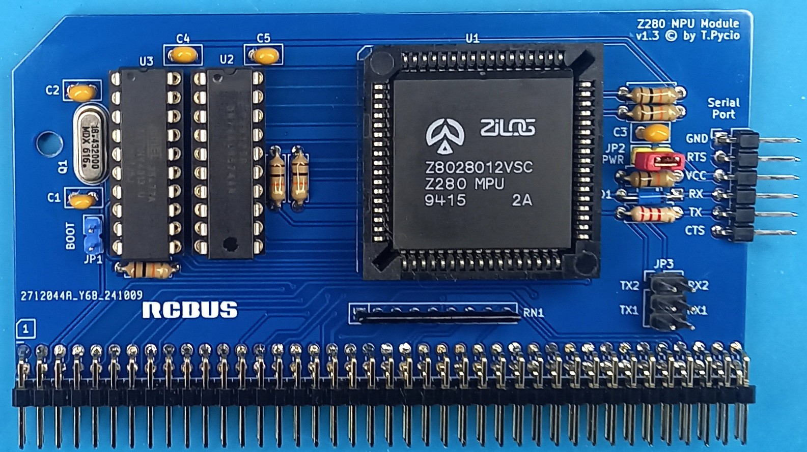
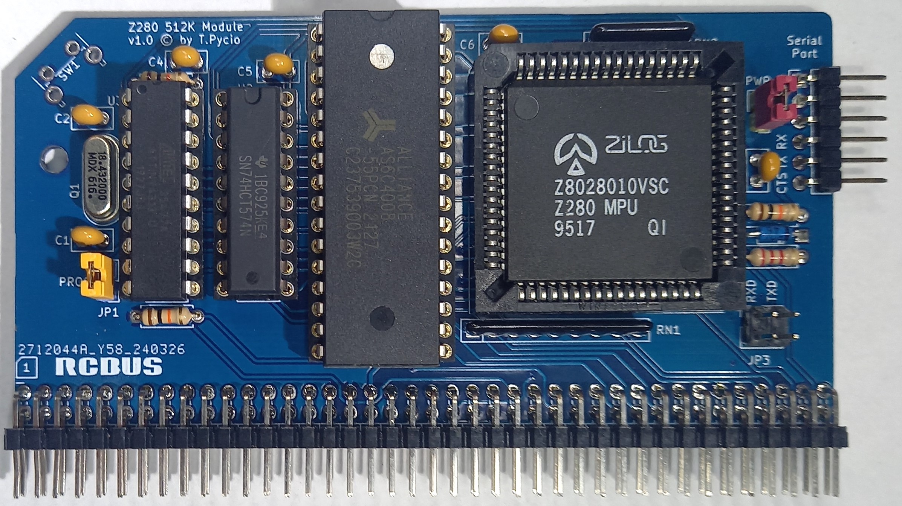

# Z280-RCBus Hardware

## Z280 MPU module (universal)

## Hardware Documentation

### Jumpers and Connectors

#### JP1 - Bootstrap

| Position | Description |
| -------- | ----------- |
| open     | disable     |
| closed   | enable      |

When JP1 is open, the Z280 starts the code from ROM from address 0.
When JP1 is closed, a serial bootstrap procedure takes place, following which the first 256 RAMs from address 0 are filled with the uploaded contents and boot from address 0.

#### JP2 - USB power

| Position | Description |
| -------- | ----------- |
| open     | disable     |
| closed   | enable      |

### Schematic

[Schematic - Version 1.3](Z280MPU.pdf)

### Bill of Materials

| Component type     | Reference | Description                                  | Quantity |
| ------------------ | --------- | -------------------------------------------- | -------- |
| PCB                |           | Z280 MPU Module PCB - Version 1.3            | 1        |
| Integrated Circuit | U1        | Z80280xxVSC - Z280 MPU, CMOS, 68 pin PLCCC   | 1        |
| Integrated Circuit | U2        | 74HCT574 - Octal D flip-flop, 20 pin DIP     | 1        |
| Integrated Circuit | U3        | ATtiny4313 AVR microcontroller, 20 pin DIP   | 1        |
| Crystal            | Q1        | 18.432 MHz, Crystal Oscillator, HC-49S       | 1        |
| Diode              | D1        | Small signal Schottky diodes BAT46, DO35     | 1        |
| Capacitor          | C1, C2    | 22 pF, ceramic, 2.5 mm pitch                 | 2        |
| Capacitor          | C3 - C5   | 0.1 uF, 50V, MLCC, 2.5 mm pitch              | 3        |
| Resistor           | R1, R3-R7 | 10 kohm, 0.25 W, axial                       | 6        |
| Resistor           | R2        | 2.2 kohm, 0.25 W, axial                      | 1        |
| Resistor Array     | RN1       | 10 kohm, bussed, 9 pin SIP                   | 1        |
| Jumper             | JP1,JP2   | Shunt, 2 pin 2.54 mm pitch                   | 2        |
| Jumper             | JP3       | Shunt, 2x3 pin 2.54 mm pitch                 | 1        |
| Connector          | J1        | 6 pin header, 2.54 mm pitch, angle           | 1        |
| Connector          | S1        | 2x40 pin header, 2.54 mm pitch, angle        | 1        |
| IC Socket          | U1        | 68 pin PLCC                                  | 1        |
| IC Socket          | U2, U3    | 20 pin DIP                                   | 2        |

[Gerber files](Z280V13.zip) prepared for production at JLCPCB

## Z280 512k module (SBC)

## Hardware Documentation

### Schematic

[Schematic - Version 1.0](Z280_512K.pdf)

### Bill of Materials

| Component type     | Reference | Description                                  | Quantity |
| ------------------ | --------- | -------------------------------------------- | -------- |
| PCB                |           | Z280 512k Module PCB - Version 1.0           | 1        |
| Integrated Circuit | U1        | Z80280xxVSC - Z280 MPU, CMOS, 68 pin PLCCC   | 1        |
| Integrated Circuit | U2        | 74HCT574 - Octal D flip-flop, 20 pin DIP     | 1        |
| Integrated Circuit | U3        | ATtiny4313 AVR microcontroller, 20 pin DIP   | 1        |
| Integrated Circuit | U4        | SRAM 512kB 62512, 32 pin DIP                 | 1        |
| Crystal            | Q1        | 18.432 MHz, Crystal Oscillator, HC-49S       | 1        |
| Diode              | D1        | Small signal Schottky diodes BAT46, DO35     | 1        |
| Capacitor          | C1, C2    | 22 pF, ceramic, 2.5 mm pitch                 | 2        |
| Capacitor          | C3 - C6   | 0.1 uF, 50V, MLCC, 2.5 mm pitch              | 4        |
| Resistor           | R1,R3-R4  | 10 kohm, 0.25 W, axial                       | 3        |
| Resistor           | R2        | 2.2 kohm, 0.25 W, axial                      | 1        |
| Resistor Array     | RN1       | 10 kohm, bussed, 9 pin SIP                   | 1        |
| Resistor Array     | RN2       | 10 kohm, bussed, 5 pin SIP                   | 1        |
| Jumper             | JP1,JP2   | Shunt, 2 pin 2.54 mm pitch                   | 2        |
| Jumper             | JP3       | Shunt, 2x2 pin 2.54 mm pitch                 | 1        |
| Connector          | J1        | 6 pin header, 2.54 mm pitch, angle           | 1        |
| Connector          | S1        | 2x40 pin header, 2.54 mm pitch, angle        | 1        |
| Push button        | SW1       | 6x6 tactile push button, angle               | 1        |
| IC Socket          | U1        | 68 pin PLCC                                  | 1        |
| IC Socket          | U2, U3    | 20 pin DIP                                   | 2        |
| IC Socket          | U4        | 32 pin DIP                                   | 1        |

[Gerber files](Z280NS1.zip) prepared for production at JLCPCB

## License

Copyright 2025 Tadeusz Pycio

This work is licensed under a [Creative Commons Attribution-NonCommercial 4.0 International (CC BY-NC 4.0) ](https://creativecommons.org/licenses/by-nc/4.0/).
